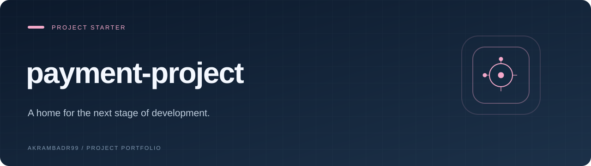

  

<strong>A home for the next stage of development.</strong>

<a href="#overview">Overview</a> · <a href="#explore">Explore</a> · <a href="#getting-started">Getting started</a>

## Overview

**payment-project** is a project repository in its initial setup stage. This page introduces the workspace; application source, installation instructions, and a runnable release have not been published yet.

## Explore

- Project identity and documentation
- A dedicated space for future source and setup instructions

## Getting started

Application setup will be documented when source is published.

## Project notes

This repository currently contains presentation documentation only. No application features or release availability are claimed.

---

<a href="https://github.com/Akrambadr99?tab=repositories">Explore the portfolio</a>

